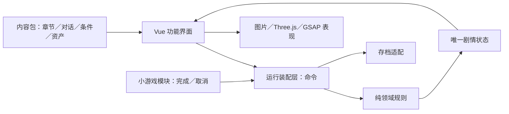

# 架构与边界

此框架服务当前五章场景叙事游戏，不承诺成为任意类型游戏的通用引擎。

2026-11-07 第四章整合：当前内容 v5、状态 v3。本地前三章内容和阅读系统保留，第四章也编排为 `DialogueBeat`；手机号消息可选元数据与通用页头／尾注并存，所有实物文字继续渐进显示。旧 `shops.ts` 冻结，仅供 v4 校验，实时第四章为 `night.ts`。具体兼容边界和存档用例见[第四章合并与兼容](第四章合并与兼容.md)。

2026-11-06更新：章内已支持多个SceneDefinition；第二、三章各三处地点。全屏情景、独立精灵与木制素材皮肤已接入。下文旧“线性章节、章内探索”的规则仍成立，章间顺序与章内通路分开处理。

入口精修更新：内容 v4、状态 v3。新增 `journey` 保存主线返回位置，`revisit` 与 `resume-journey` 支持回访。`recipes`、`collection` 和 `progression` 仍是内容配置；解锁、教学条件和收集物研究统一经核心规则。翻书、逐字落墨与物件展开属于表现。成套新 UI 以方形框角、直边和独立花饰装配，见 [入口与第一章精修](../planning/入口与第一章精修.md)。

## 数据流

第四章更新（2026-11-07）：内容 v5，状态仍 v3。三场景与双单分装使用现有命令、条件与一次性奖励；新增 `MinigameDefinition.packing` 仅配置两份要求。`Exhibit.phone` 配置消息时间及页头，不再把深夜订餐屏幕显示成清晨备忘。旧第四章内容冻结用于存档验证与迁移，当前装配改为 `chapters/night.ts`。详见[第四章制作与验收](../planning/第四章制作与验收.md)。

第一章镜头试作：`SceneDefinition.camera` 配置取景，`Hotspot.cameraView` 引用同场景的取景 ID，内容检查校验引用和数值。相机变换、横向观察位置与 GSAP 动画只在表现层组件中存在，不新增剧情事实或存档版本。世界画布包含物件及命中区域，菜单与标题留在画布外，见[景深与镜头设计](../planning/第一章景深与镜头设计.md)。

老宅与第二章更新：退出交互自动回到标准取景，连续面板切换保持当前取景。姿态变体可同时声明资产、位置、尺寸与取景引用；`SceneDefinition.decorations` 描述按既有条件显示的空席等陈设，不产生交互命令。陈设资产、条件和姿态引用也进入内容检查。只有明确配置 `journalLink` 的实体书才提供食谱入口，陈家的账本使用自己的封面与内容。这些字段是表现数据，存档仍为内容 v4／状态 v3。

## 模块职责

| 目录 | 输入 | 输出 | 不应承担的工作 |
| --- | --- | --- | --- |
| core | ContentPack、GameState、Command | 校验后的新状态、反馈 | 操作 DOM、播放动画、读取 localStorage |
| content | 人工编写的内容与资产说明 | 类型化内容包 | 改状态、直接调用界面、执行任意脚本 |
| runtime | 界面命令、存储端口 | 响应式状态、自动保存、选择前记录 | 编写章节专有分支 |
| features | 当前状态和配置 | 交互命令／小游戏结果 | 自行发属性、修改背包或越过条件 |
| presentation | 物件类型、参数、减少动画设置 | 渲染与视觉反馈 | 决定剧情完成与奖励 |
| infrastructure | 存储／音频请求 | 保存结果、恢复数据、声音反馈 | 决定人物关系与章节走向 |

`App.vue` 负责页面装配和单个面板的展示，不持有章节专有任务逻辑。剧情实际效果集中在 `core/engine.ts`，不是散落在各组件的点击回调里。

## 内容契约

- 章节是可排序的数据，当前使用显式 `next` 连接五章。第一章和第五章都是实际章节，标题画面是独立阶段。
- scenesOf/sceneOf/hotspotsOf集中处理章内场景。GameState记录sceneId与seenScenes；move命令只经过当前场景开放的link，所有交互与小游戏提交只读取当前场景。
- 热点可携带sprite及状态variants。它们是独立图片资产，悬停、聚焦上浮；variants可改变物件位置或换图。观察文字可按事实切换版本，核心仍负责是否发放线索。
- 任务单独登记，章节引用自己的主任务；支线可由事件激活或设置 autoStart，不限制一章一个任务。
- Hotspot 描述位置、可见条件、完成标识与交互类型；支持观察、对话、小游戏。
- Condition 支持标志、线索、道具数量、属性阈值、任务结果、all／any／not。
- Effect 支持增加线索、标志、道具与属性，以及变更任务结果。
- Action 拥有稳定 ID，奖励按 `onceKey ?? id` 去重。两种方式取得同一物品时共享 onceKey。
- DialogueChoice 可声明 decision，将互斥决定记在当前历史里；重复打开对话不能撤销旧决定。
- Dialogue.entries 可按已有事实选择重新交谈的入口；未说完的必要指引优先续接。节点的 portrait、direction 只描述表现，不持有游戏规则。
- DialogueNode 可选 `beats` 描述同一节点内的说话与叙述回合，各自有正文、说话人与立绘。`content/narrative.ts` 从唯一回合稿合成兼容 `text`；`presentation/dialogue-readings.ts` 按回合分页，无回合的旧内容继续显示单人正文。回合不附条件或 Effect，推进回合不提交剧情选择。
- 观察交互可附带 Exhibit 纸面内容与 activityId；书页阅读和物件活动是两个独立状态，活动也有自己的条件检查。
- Chapter.beats 描述章内阶段目标，character 描述场景人物位置，均由内容配置；核心不按某个角色名分支。
- 小游戏由 module 查注册表，异步加载独立 Vue 组件。组件接收定义、只读状态和设置，发出 completed 或 cancelled；未知模块可安全关闭。
- 结局按配置顺序匹配，最后一个必须无条件兜底。数字仅为占位，核心不包含某个店铺名或属性名。

当前扩展方式是 TypeScript 数据与组件。没有引入任意脚本 DSL、可视化剧情编辑器或事件总线；确有需求时另行评估。

## 状态与存档

开发者测试通过运行时 `RuleOptions.developer` 放开前置，使用 `dev-jump` 与 `dev-dialogue` 统一命令跳转。开关不写进领域状态，正常与测试档位、关键选择内存检查点分别保存；退出恢复正常会话。正常模式继续执行全部门槛。具体入口见[开发者测试工具](开发者测试工具.md)。

剧情状态包括章节、阶段、访问记录、对话游标、线索、背包、属性、任务、奖励账本、关键决定与成就。界面开关和未提交小游戏参数属于临时状态，不写成剧情事实。

有效命令生效后写自动存档；关键选择先写独立检查点，再提交结果。刷新恢复已完成的动作，小游戏本轮从头操作。手动读取和导入先校验，不用无效数据覆盖内存。

存档外壳仍为 v1，领域状态为 v3、当前内容 v5。旧内容 v4 用冻结的第四章短稿完整校验后迁移：前三章保留，未完成的旧第四章从店门重读，已结束的保留原结果并标记旧版，不推断取餐或私札。旧内容 v2／状态 v1 先经过原迁移；旧内容 v3／状态 v2 的第一章从精修入口重读，后续章节补齐主线返回位置，再进入当前版本。读取不改写原文件，无效数据仍被拒绝。新增必需状态、改 ID 或语义时仍须提供迁移或提升版本，不以类型断言冒充迁移。

关键检查点写入失败时，暂存一份本次页面会话中的检查点并明确警告；自动存档失败也会报告。玩家仍可游玩与导出，但刷新将失去这份内存记录。设置保存失败只影响刷新后的恢复。

五个档位分别为自动、关键选择前、手动一至三。占位内容有独立命名空间，不读取或覆盖旧 game-lab 的存档。

跨周目解锁目前没有单独的账户／全局状态。未来若增加，应与当前角色知识分开，不能因玩过另一结局就让角色自动获知本周目没找到的证据。

## 表现与资源

2026-11-08 第二章生活对白版：`Interaction` 的对白可选 `entry` 指定本物件入口，`DialogueChoice.activityId` 可在选择后接续同章、当前场景的玩法，核心先核验物件可用性与前置，界面仅展示。开发者模式会定位到对应玩法场景。新增 `reward` 条件读取原有动作账本，避免为教学完成另加必填存档状态；普通模式继续执行全部限制。

`DialogueNode.versions` 按条件选择对白回合，`Entry.versions` 按条件选择书内记录，均不携带剧情效果。对白仍按稳定节点保存，书页通过 `entryText` 读取当前版本；所有新引用进入内容校验和全站 Markdown 导出。六份真实旧 v5 档验证全部状态保持，内容与状态版本未改变。完整边界见[生活对白版接入](../planning/第二章生活对白版接入.md)。

2026-11-08 教学精修：可选 `GuideStep.focus` 与 `chrome` 只配置聚焦输入和场景界面阶段，不产生剧情效果。`useTutorialPresentation` 在连续面板、交谈与相机回正期间保留已呈现的步骤，结束后才接入新的进度条件；收起状态只在页面内存在。场景按钮、拖动与应用入口共同限制非目标物件，原生物件／对白面板继续隔离背景输入。第一章读书前简化界面、书签阶段显示食谱入口、出门阶段开放完整界面；其他章和开发者模式不新增聚焦门槛。见[阅读与窗口教学](../planning/渐进阅读与窗口教学.md)。

对白和物件的显字、选项出现时机由 `presentation/useReadingSequence.ts` 管理，读完或快读只改变当前界面的游标，不发剧情命令。节点切换和组件销毁会清理计时；减少动画立即完成显示。教学数据使用既有进度条件，`target` 指向物件，`control` 可指向书、菜单或出门按钮；连线和窗口布局只在表现层计算。新增指向须通过内容校验。教程按钮继续调用原物件或菜单入口，不另行写存档状态。

长文本再经 `narrativePages` 分段，翻到下一段只改界面游标，最后一段才开放原选项。食谱的 `note` 为可选内容文字，纸张材质为独立资源，不把文案烘焙到贴图。回访与人生记录分别配置条件：`revisitUnlocked` 在第二章任务 active 即成立，`lifeUnlocked` 仍要求陈家收束。仍使用既有回访与恢复命令，行程返回点和存档版本不变；教学的 `home` 指向场景中的回家按钮。

第三章更新：复制的家具前景同时复制背景明暗，避免蒙版边缘产生色差；座位位于家具前侧时按实际层级显示完整人物。资产可选 `inscription` 声明独立字体文字，限制在有区域的图上显示一至三行。观察版本可附自己的 `exhibit`，手机页头、尾注与屏幕内容来自数据，按已有决定显示。服务排队继续由纯计算 helper 判断，点选与拖动只改变小游戏临时队列，完成与奖励仍经统一规则。

资源用稳定 ID 查表，public 内保存当前工程的独立副本。换文件 URL 不影响规则。当前背景图片缺失时仍显示热点；WebGL 无法初始化时，保留滑块、帮助与完成按钮。

Three.js 在小游戏打开时才加载。物件舞台退出时销毁 GSAP 动画、ResizeObserver、几何体、材质、纹理与 WebGL renderer；模型异步到达时若已退出，会直接释放。组件销毁后不提交结果。

已提供 GLB 可选入口，但当前测试关卡用几何物件占位；正式模型的原点、尺寸、网格命名和材质规格待确定。3DGS、自由漫游和复杂物理不是这一轮已实现的功能。

## 应按证据调整的边界

- 同类小游戏可复用组件；机制变化较大时新增模块，不往一个巨型组件里加大量章节判断。
- 当前是线性章节、章内探索与保留进度的回访。若进一步加入多区域地图，先定义时间与场景访问规则，再扩展旅行命令。
- 剧情还原和存档校验能保证结构与引用有效，不能替代对所有故事逻辑的校验。
- 若需要严格防篡改、云端同步或账号系统，当前本地存储不提供这些能力，需新适配与相应规则。
