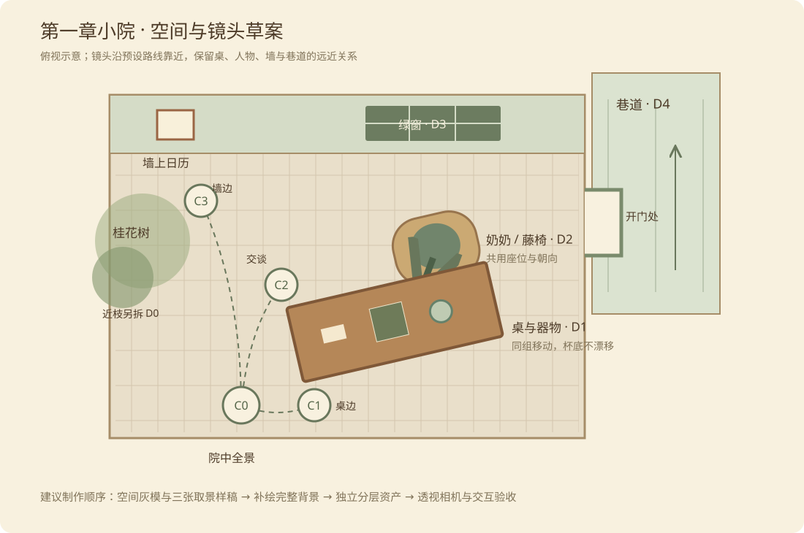

# 第一章景深与镜头设计

后续更正：用户指出原长桌结构缺少生活逻辑，第一章主环境改按[老宅生活布局](第一章老宅生活布局.md)重做。下文的小院长桌构图与取景点保留为前一版试作记录，不再作为当前摆放约束。

2026-11-06。以奶奶的小院验证空间与交互，不据此锁定新剧本。延续长明巷、暖木与桂花的美术方向。

## 本轮已经落地的部分

- 图集显示增加独立裁剪边界。不同长宽比的物件框不会再露出相邻图块；没有靠拉伸图片或加大透明度阈值掩盖问题。
- 场景人物改用朝左就坐的新素材，与藤椅同向，并重新对齐座位。对话使用单独的正面立绘。人物悬停只提亮，保持坐姿接触点；桌上物件仍可轻微上浮。
- 第一章接入全景、桌边、奶奶身旁、墙边四种取景。点击物件后先推进约 0.7 秒，再开始原有交互。关闭面板保留近景；“退回院中”或再次按 Esc 返回全景。
- 桌边拖动使用变换后的世界画布计算位移，物件、命中区域和落点一起移动。镜头位置不写入剧情存档。
- 新增 `npm run preview:local`，通过本机 Chrome／Edge 做实际点击与截图验证，见[本机浏览器预览](../engineering/本机浏览器预览.md)。

**目前可玩的镜头试作使用同一世界画布的平移与缩放。墙、藤椅、桌子仍有部分画在同一底图中，尚未形成不同深度的透视视差。** 它用于评审靠近的时机、距离与返回操作；完整景深按下面的方案重建。

## 小院怎样重新组织

保留右侧通向长明巷的门、后方绿窗、左侧日历和桂花。木桌稍向画面右下方斜放，留出左下方进入院子的空间，并露出桌子前后两侧的地面。奶奶坐在桌后偏右，身体和椅子一起朝向桌前偏左的主角。相框先保留在桌边，避免画面位置与对白再次冲突。

图中位置为搭景草案，不代表真实建筑测绘，也不预设自由行走。四个取景点之间沿预设路径过渡。

| 深度 | 内容 | 靠近时应看到什么 |
| --- | --- | --- |
| D0 最近 | 入口木门边、少量桂枝与叶片 | 移出画面最快，形成进入院子的感觉；不遮挡点击目标 |
| D1 近景 | 木桌、手机、书、信、茶、相框 | 桌沿与物件一起放大，物件始终落在同一桌面上 |
| D2 中景 | 奶奶、藤椅、座位接触阴影 | 比桌面变化慢；靠近交谈时保留自然的肩部与面部构图 |
| D3 后景 | 墙、绿窗、日历、门框 | 相对移动较小；日历必须贴在墙上，不能像桌面卡片漂浮 |
| D4 远景 | 门内暗部、门外巷道与远处屋檐 | 变化最慢，保留通向院外的深度 |

桌、器物是一组空间关系，人物、椅子是另一组。不能给同组成员随意套不同视差比例，否则杯底会滑离桌面，奶奶会离开椅座。

## 四个取景与交互节奏

| 取景 | 触发 | 构图与操作 |
| --- | --- | --- |
| 院中 C0 | 进入、退回 | 能辨认奶奶、桌边物件、墙上日历和巷口；保留空间关系 |
| 桌边 C1 | 点书、手机、信、照片、茶 | 镜头向桌前靠近，略向下看；先看到物件变大，再翻开或拿起 |
| 奶奶身旁 C2 | 点奶奶 | 镜头靠向座位，接近坐下交谈的眼高；对话框放在面部下方 |
| 墙边 C3 | 点日历 | 镜头平移靠近左墙，桌沿从近处让开；日历仍与墙保持接触 |

悬停只给选中反馈，点击才移动镜头。同一位置连续看几件物品时，不反复推拉。关闭阅读面板后仍留在当前取景，方便接着观察；返回入口始终明确可见。减少动画时直接切到目标取景。

窄屏通过下方物件入口选择远处的人或物件时，画面横向移动与镜头推进同时进行；退回院中后恢复靠近之前的横向观察位置。

镜头移动期间取消、离开场景或卸载组件，应取消尚未开始的交互，避免晚到的对白突然打开。回访继续使用原有物件状态、选择和主线返回点；镜头不是新的剧情进度。

## 建议的实现方式

采用 Three.js 透视相机与分层手绘场景。墙、门、地面、桌面用简单平面或盒体承载绘制好的材质；桌上物件按实际摆放角度落在桌面上，人物使用竖直图层。优先做好受限镜头的观感，再评估更多移动范围。

藤椅至少拆出椅背、人物、前侧扶手三层。人物与椅子共用座位定位，面部可转向主角，髋部和膝盖方向仍须与座椅一致。桌上的书和信适合平放表面；茶壶等有明显体积的物件可使用轻量模型或专门为取景角度绘制的素材。

相机以平移、前进、轻微俯仰为主，初版不绕到人物或家具背后。先用灰模确认所有取景都不会穿过桌子、露出纸片侧面，再制作正式素材。景深模糊只轻微辅助远近，交互物、文字和菜单保持清楚。

内容中继续配置物件、视角和可见条件；表现层负责镜头、投影和动画；规则层继续处理观察、递茶、对话与奖励。下一阶段增加世界坐标时，也不把 Three.js 类型或镜头状态写进核心规则与剧情存档。

## 下一轮美术交付

1. 先做同一小院的全景、桌边、交谈三张构图样稿，并用灰模检查相机路径。
2. 拆出空场景、地面、后墙、门与巷道、近处桂枝、桌子、椅背与扶手、人物和每件器物。补绘被人物、桌子挡住的部分，不能继续从完整截图里硬切一角充当前景。
3. 按相同透视、物件尺度和左上方光源制作。日夜版本共用布局、定位点与遮挡轮廓。
4. 先以约 3200×1800 的主构图和四周 10%–15% 的可移动余量检查近景清晰度，再制定运行图压缩规格。现有 1672×941 底图的放大试作不能代表正式近景精度。
5. 每件素材单独导出透明源图。检查黑、白与棋盘底下的轮廓、邻物残片、背景色晕和接触阴影；批量图集只在源图验收后再打包。

本轮人物来源及完整提示词见[第一章景深与素材修正](../art/第一章景深与素材修正.md)。旧底图、旧人物与图集继续保留。

## 验收边界

本轮已验证本机 Chrome 的首页、人物推进与对话、日历翻面、手机点亮、桌边近景拖茶、返回全景后的状态保留。窄屏通过物件列表进入人物近景并显示对话；这属于桌面浏览器缩窄验证，尚不等于真实触屏设备验收。

正式分层版本还需检查前后景视差、穿插遮挡、四周补画、夜间一致性、清晰度与设备性能。自动检查和截图不能替代这些后续验收。

实测对照：[院中全景](../art/previews/arrival-overview.png)、[奶奶身旁](../art/previews/arrival-near.png)、[窄屏对话](../art/previews/arrival-mobile-dialogue.png)。
