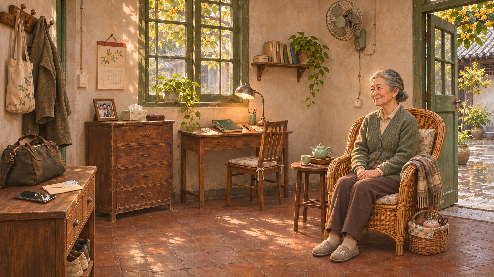

# 第一章老宅生活布局

2026-11-06 后续调整。用户指出：长桌铺满物件缺少生活逻辑，先前背景构图需要重做。本轮将第一章主要环境改为奶奶老宅的堂屋，保留长明巷、暖木、桂花与原有委托流程。场景组织以奶奶日常使用、主角刚到家和房间通行为依据。

## 先让房间能够生活

从进门处看进去：左手是放行李和换鞋的低柜，里侧是保存家用物品的斗柜；窗下的写字台用来记食谱，右边是奶奶常坐的藤椅和小茶几。中间露出地面，能走到窗边，也能从右侧门去小院。桂花主要长在屋外，不把室内铺成景观布景。

这张图先用于核对整体关系。运行底图将人物和可交互物件移除，再以独立素材放回各自位置，避免同一物件出现两份。

| 物件 | 放在哪里 | 为什么在这里 | 交互后的关系 |
| --- | --- | --- | --- |
| 手机 | 进门低柜上，平放在行李旁 | 主角刚回家，随手放下自己的东西 | 拿起看草稿后放回；不再复用商家手机支架 |
| 信和票根 | 同一进门柜，靠近旅行包 | 主角从外地带回的随身纸件 | 看信、折好放回，不摆进奶奶的茶盘 |
| 旧合照 | 斗柜上，旁边是纸巾与眼镜盒 | 长期摆在家里、奶奶抬眼能看见的位置 | 拿起翻背板，再放回柜上 |
| 日历 | 靠开关的墙上 | 看日期、记待办，伸手可以翻页 | 固定在墙边，和照片分开 |
| 百味录 | 窗下写字台，旁边有笔和台灯 | 奶奶写方子、整理纸条的地方 | 出门装包后桌上暂时不再留一份，回访时可带回 |
| 茶杯 | 奶奶座旁的小圆茶几上 | 奶奶已经倒好的茶，坐着能取到 | 只把杯和底碟挪近，茶壶、茶盘留在原处 |
| 奶奶 | 靠窗的藤椅上，脚落在地面 | 身旁有针线篮和披肩，是她正在使用的坐处 | 人物、椅子和坐姿接触关系保持一致 |

这些位置服务当前可玩样段，不据此锁定人物完整生平、病症或宅子的正式建筑设定。

## 接入时一起改的内容

- 移除旧长桌的前景遮罩。新环境有实际用途的家具和可通行地面，不靠把物件分散到几张空桌上解决问题。
- 人物场景素材包含完整坐姿与藤椅，不再把半身立绘贴在桌后；对话仍使用独立立绘。
- 取景分别对应进门柜、斗柜、写字台、墙上日历、座位和茶几。窄屏对靠近画布左右边缘的目标，按投影位置移动观察窗口。
- 用户追加要求：退出当前物件或结束对话后，镜头自动恢复标准取景，窄屏恢复靠近前的观察位置。翻书转入食谱、整理书签等连续面板切换期间保持取景，直到整个交互结束，不再要求手动回正。
- 调整物件的底部定位，使书、相框、手机和杯子接触各自的承托表面，不因图片留白浮在半空。
- 同步修正教学与对白的指向。奶奶可以指向窗下的书，不能隔着房间伸手把书推过来；照片改称柜上的合照。
- 沿用已有物件、线索、动作、任务与场景 ID，保持存档和主线返回点。新背景、人物和物件另存版本，不覆盖旧素材。

本轮重点是环境构图与物件生活逻辑。镜头仍采用已接入的平移缩放表现；独立景层的透视视差继续按后续美术与空间验证制作。
