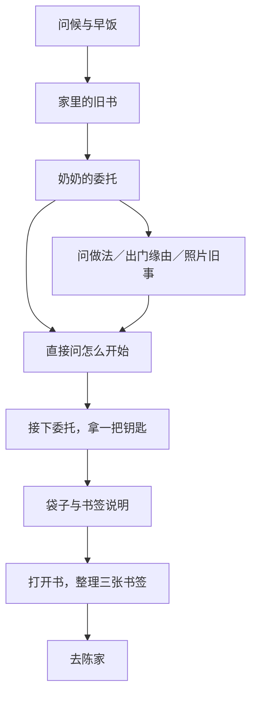

# 首章流程与琴记精修

2026-11-10。按测试反馈先修第一章推进，再按前两章的生活对白、主角心绪和自然物件交互要求精修第三章。新增叙事仍为 Demo，不确定主角职业、年龄或新的身世；第二章用户原稿和运行阅读稿均保留。

## 第一章的两处问题

原先“到店里问什么”“是不是想让我出门”“照片里的包子”三个话题结束，都回到委托菜单。出口虽然存在，玩家仍会一再看到同样的问题，选择没有形成清晰的前进方向。退出时也只按少数阶段标记重新找入口，问到一半或准备接委托时，容易又读回前面。

旧书还有一处入口差异：从场景点书时会携带书签任务，从左下《百味录》打开却清空来源，任务随之消失。关掉重开同一个常用入口仍看不到书签，形成容易被当作卡关的路径。

本轮将主会话改为有限的单向接续：

可选话题说完直接接“怎么开始”，不返回委托菜单。退出未完问题、准备接委托或听说明时，再交谈分别接对应步骤，不重新问早饭、发钥匙。开场没问的事，仍能在当章及之后回家补问；这些会话结束回房间，不再穿过委托主线。已有的线索或话题完成后，相关一次性问题从选项里退出；尚未发现的正向证据仍保留提示。

待整理的书签现在由当前场景和实际进度确定。场景旧书、左下入口都能进入同一任务；关闭或取消不会让入口丢失，完成后不再重复出现。整理正确后由原核心命令发书和任务奖励，表现层不改剧情标记。

## 对话检查与兼容

内容检查现在检查全部对白的 next 接续图，自循环和多节点循环都会报错，即使另有出口也不放过。正常剧情标记继续只积累，界面开合、选中书页与显字游标不当作剧情开关。

第一章现为 25 节点。测试从实际开局遍历 32 条含可选照片的会话路线，并对每个步骤分别检查继续、退出重进后的通关；都能得到一把钥匙、一本书并进入第二章。遗漏话题也能在提前回家时补齐，不重发数值或物品。

旧节点和动作 ID 保留，原奖励、条件与奖励键不变；三条可选话题的接续改到委托步骤。旧存档停在原场面仍可继续，没有新增必填字段，内容 v5／状态 v3 保持。

## 第三章

琴记现为 33 节点、21 处交互，其中 14 处物件观察已精修。加入小满在熟人面前想搭把手、听见简历时的停顿、差点替别人承诺明天、终于坐下来吃自己那碗面的感受。琴姐、阿川、田姨仍有各自要做的事，小满不替两位经营者作决定，也不凭一段回忆就把事情劝好。

门帘、面案、调味瓶、点单簿、改衣单、退单和接单手机各自带出人物与当下的事，纸上的字改为实际菜单、订单、取消状态等内容。抄纸未执行时只写打算，不提前声称已经有副本；不统一按材质、童年和感悟写三段。

阿川算锅后再谈回来的事，田姨记好时间后再补问门帘或改单，各自有独立入口，不再回跳成循环。原“再考虑”改为明确转到先处理堂食的路线；三种结果及原奖励保留。

排单仍检查人、锅、前后顺序、半份与不葱，但有效后一次下锅、出餐，取消核对成功后再确认的步骤。三个结尾中途退出，仍回到未完收束；吃过自己的面、写下原记录后才开放离店。用过的筷子从原架子移除；窗边空碗和杯子尚待收拾，旁白不再先写已经搬走。

旧纸和手机保留原分支区别：两单试一周、先改堂食传单、仍未改接单量不会混写。布局、原素材、取景和三店的其他结果保持；人物、书页和原版本存档继续复用。

## 验证与阅读

自动检查与普通模式浏览器实测分开记录，见[验证记录](../engineering/验证记录.md)。[第一章阅读稿](../百味录_第一章_归巷_生活对白版.md)、[第三章阅读稿](../百味录_第三章_窗边那一桌_生活对白版.md)和[全站文本](../百味录全站剧情文本.md)已同步。

本轮没有新增或覆盖游戏图片，截图均为独立本机浏览器中的现有素材：[左下入口中的书签](../art/previews/arrival-noon-v9/book-task-start.jpg)、[手机入口中的书签](../art/previews/arrival-noon-v9/book-task-earlyBook.jpg)、[琴记见面](../art/previews/arrival-noon-v9/qin-arrival.jpg)、[手机排单](../art/previews/arrival-noon-v9/service-mobile.jpg)、[面案的回想](../art/previews/arrival-noon-v9/board-story-True.jpg)、[实际两单设置](../art/previews/arrival-noon-v9/limited-phone-True.jpg)、[浏览器记录](../art/previews/arrival-noon-v9/browser-report.json)。
