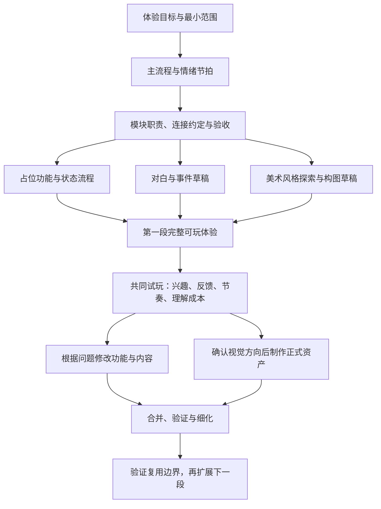

# 开发原则与协作约定

更新：2026-11-05。以下两组原则来自用户明确要求，作为后续策划、任务拆分和实现评审的依据。执行方法是对原则的落地建议，可根据实际体验调整。

## 一、策划目的：留住注意力，让玩家真的觉得好玩

从打开网页，到开始参与，再到游玩一段时间之后，都需要让玩家愿意继续。

- 打磨有内涵的故事，让人物、事件和玩家行动值得关心。
- 游戏性借鉴经典游戏设计中的正反馈：行动得到清晰回应，玩家能够感知进展、变化与收获。
- 美术风格统一且优秀，开场能吸引注意，也能持续服务体验。
- 正常叙事之外要有幽默和轻松的节奏，避免连续游玩后变得单调。
- 在具体细节中留下小巧思，让观察、探索和尝试得到额外回应。

落地时，每段体验至少回答：

1. 玩家为什么愿意开始？开场怎样建立兴趣，并让他知道可以做什么？
2. 玩家做出动作后，立即看到、听到或理解了什么回应？
3. 玩过一段时间后，有什么新的信息、变化或期待值得继续？
4. 哪里适合幽默、轻松或意外的小发现？它是否符合人物与情境？
5. 哪些细节值得玩家注意？忽略这些细节时，主线是否仍可理解与完成？

正反馈可以是动作手感、声音、人物反应、环境改变、发现或剧情推进，不必一律变成积分和奖励弹窗。幽默与巧思需要服务整体语气；数量与出现频率通过试玩判断，不机械规定每个场景都要有笑点。

## 二、开发原则：解耦、先定整体框架、先跑通再细化

### 功能解耦

故事内容、美术与声音、输入和玩法规则、表现、流程状态、加载与存档保持明确边界。模块的连接约定要清楚，常见内容修改应集中影响少数模块。

用实际变化检查边界：改对白、换资产、改输入方式，分别会影响什么？不能以文件数量或抽象层数代替解耦效果。

### 总分式开发，明确任务依赖

先定义整体体验、主流程、模块职责、接口与验收，再拆分任务并填充内容。AI 拆任务时须写明输入、前置依赖、输出与验收方法，并标出可并行部分。

框架先定到能支撑第一段完整体验的程度；用可玩内容验证它。发现新需求后允许有证据的调整，不以“以后绝不重构”为承诺。

### 先能跑起来，再逐步细化

功能先跑通闭环，再完善异常路径、输入反馈和体验细节；美术先用占位与草稿验证构图、比例和操作，再统一风格、替换资产与精修。占位版本与正式质量的验证目的要说明。

不要等全部正式素材齐备才开始联调。每轮改动应保留一个可运行、可试玩的版本，说明本轮完成程度及未验证范围。

## 三、建议任务依赖图

下面是执行建议，不是已批准的具体故事或完整制作排期。

风格探索可与占位功能并行；正式资产制作依赖风格与规格确认。新增章节依赖第一段对框架和体验的验证。每个模块各自通过检查后，还须共同试玩整体节奏。

## 四、人与 AI 的协作

人类成员主导创作方向、审美与体验判断，AI 承担方案解释、任务依赖梳理、工程实现、调试和验证。人类不需要先学习手写技术栈，AI 应用可理解的语言解释技术如何帮助达成目的。

每轮交付说明：

- 本次变化与它服务的体验目标。
- 可以查看或游玩的入口。
- 已有验证证据与覆盖范围。
- 尚未完成、未验证或依赖其他任务的事项。

类型检查、构建成功、截图与录屏各能证明的内容不同。关于好玩、美术和节奏的判断，必须有可体验的版本支撑。
